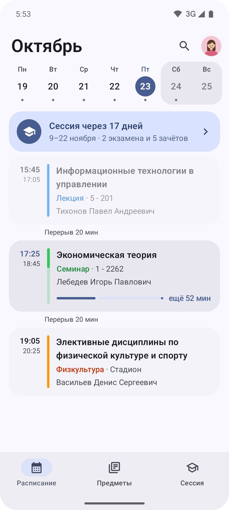
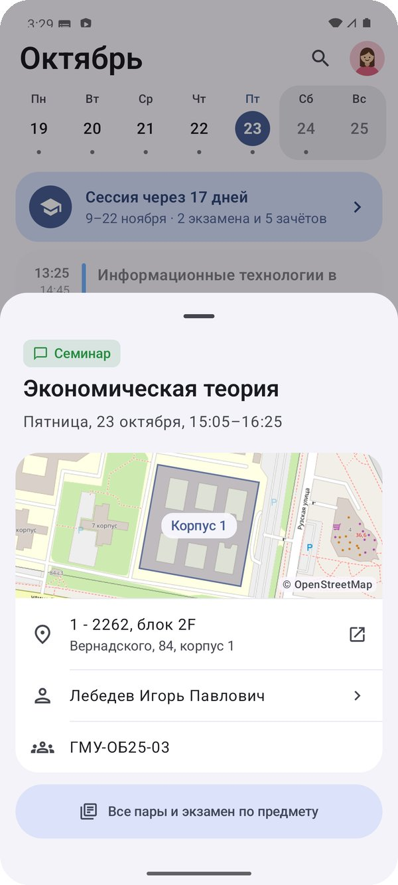
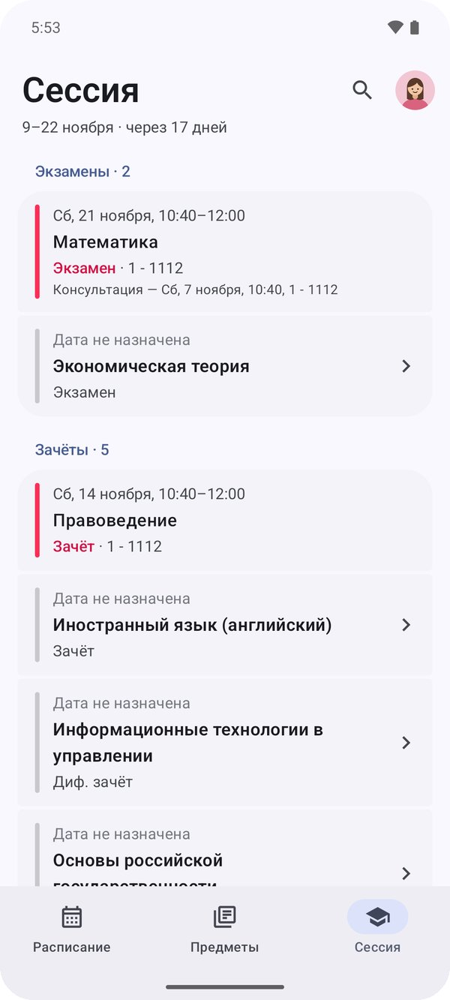
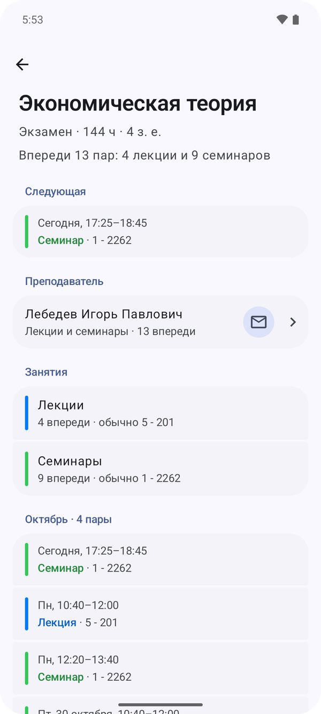

# Расписание студента

Неофициальное приложение для Android с расписанием РАНХиГС.
Расписание берётся из личного кабинета студента (my.ranepa.ru) и открывается
сразу, без браузера и без входа в ЛК каждый раз. Версия для iPhone —
[ranepa-sync-ios](https://github.com/ranepa-unofficial/ranepa-sync-ios).

> Приложение не связано с РАНХиГС и не поддерживается академией.

<p align="center">
  
  
  
  
</p>

## Установка

Скачай APK из [последнего релиза](https://github.com/ranepa-unofficial/ranepa-sync-android/releases/latest)
и открой его на телефоне. Нужен Android 8.0 или новее.

## Что умеет

- Пары дня с текущей и следующей парой, на планшете — карточка пары рядом с лентой.
- Расписание до конца семестра, работает без интернета.
- Уведомления о переносах, отменах и смене аудитории, напоминания о паре.
- «Предметы» и «Сессия» из плана обучения: экзамены, зачёты, преподаватели.
- Баллы БРС и посещаемость, уведомление о новых баллах.
- Виджеты, Live Update, плитка в быстрых настройках, календарь «РАНХиГС».
- Корпус на карте и выбор приложения карт: Яндекс Карты, 2ГИС, Google Maps.

## Приватность

Своих серверов и рекламы нет. Логин и пароль вводятся на настоящей
странице ЛК, приложение их не видит. Расписание, профиль и баллы хранятся только
на телефоне. Разработчику уходит только анонимная статистика через
[TelemetryDeck](https://telemetrydeck.com/privacy/): сколько пользователей и какие
экраны открывают, без логина, ФИО и группы.
Подробнее — в [политике конфиденциальности](PRIVACY.md) и в разделе
[«Вход и токены»](docs/auth.md).

## Документация

- [Вход и токены](docs/auth.md)
- [Как обновляется расписание](docs/sync.md)
- [Как это устроено](docs/architecture.md)
- [Сборка и разработка](docs/development.md)
- [Выпуск новой версии](docs/release.md)

## Сборка

Нужны JDK 21 и Android SDK с платформой 37.

```bash
./gradlew assembleDebug
```

Тесты, демо-режим, релизы и своя сборка — в [docs/development.md](docs/development.md).

## Состояние

Версия 1.0 — первая для Android (Kotlin, Jetpack Compose, Material 3).
Релизы с готовым APK — в [GitHub Releases](https://github.com/ranepa-unofficial/ranepa-sync-android/releases),
закрытое тестирование — в RuStore.

## Лицензия

[MIT](LICENSE)
